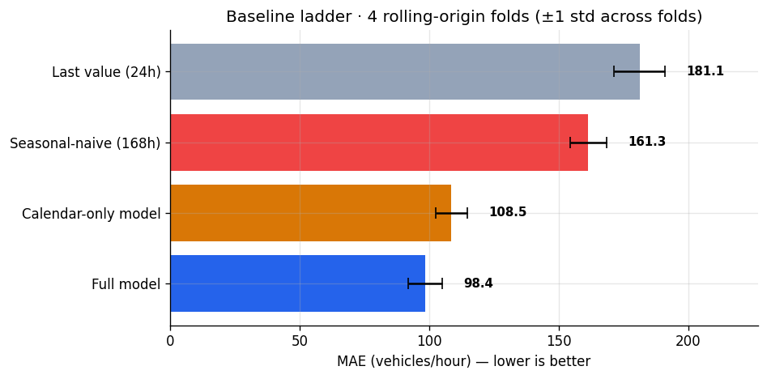
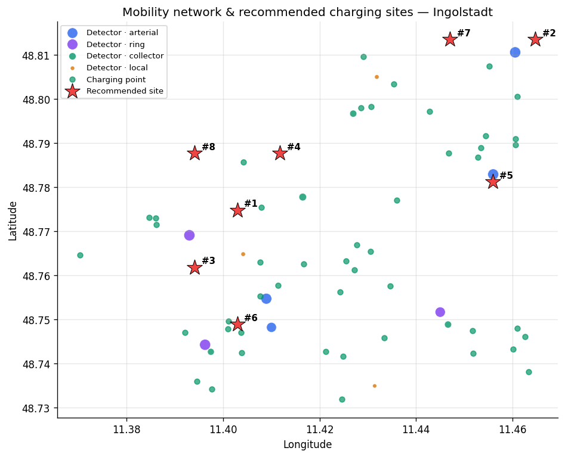

# IngoMobility — Ingolstadt Open Mobility Intelligence

[](https://github.com/vxx2207/ingolstadt-mobility-intelligence/actions/workflows/ci.yml)

**[Live dashboard](https://vxx2207.github.io/ingolstadt-mobility-intelligence/)** | [Analysis report](reports/strategy_report.md) | [How this was verified](docs/verification_report.md)

**Where should Ingolstadt put new EV charging points, which bus lines are under-served, and how much traffic is coming tomorrow?** This repository answers all three from open mobility data, with one reproducible pipeline: data-quality gate → DuckDB star schema → forecasting model → interactive dashboard → written analysis.

| | |
|---|---|
| **Problem** | Cities publish mobility data but rarely turn it into decisions. Three concrete decisions are modelled here: charging-point siting, bus service gaps, and short-horizon traffic demand. |
| **Data** | Public transport (GTFS, VGI/INVG) · hourly weather (DWD Open Data) · EV charging (OpenStreetMap/Overpass) · hourly loop-detector counts. Schemas are the real ones — see [Data & honesty](#data--honesty). |
| **Built** | Python ETL, **DuckDB star schema** (7 dims · 3 facts · 5 marts), **Java 11** data-quality gate, scikit-learn forecasting with rolling-origin CV, Plotly dashboard, 60+ tests, CI on 3 operating systems. |
| **Headline result** | The demand model reaches **MAE 98.4 ± 6.6** (R² 0.84) across 4 CV folds — **9.4 % better than a calendar-only model** and 39 % better than a seasonal-naive baseline. |
| **Run it** | `pip install -r requirements-dev.txt -c constraints.txt && pip install -e . -c constraints.txt && python -m ingomob.cli run-all` |
| **See it** | `python -m ingomob.cli serve` → <http://localhost:8000> · deployed live from this repo via GitHub Pages |
| **Limits** | Default data is synthetic-but-realistic; live mode covers 3 of 4 domains. Read [`docs/limitations.md`](docs/limitations.md) before quoting any number. |



---

## Why the headline number is stated that way

A model is only as good as the baseline it beats. Reporting a single hold-out against a single weak baseline is the most common way portfolio projects flatter themselves, so this one reports a ladder, averaged over **4 rolling-origin folds** with 14-day horizons:

| Predictor | MAE (mean ± std) | R² |
|---|---|---|
| Last value (t−24 h) | 181.1 ± 9.9 | 0.47 |
| Seasonal-naive (t−168 h) | 161.4 ± 7.1 | 0.57 |
| Calendar + weather model | 108.5 ± 6.2 | 0.81 |
| **Full model (lags + calendar)** | **98.4 ± 6.6** | **0.84** |

The honest headline is the **9.4 % gain over calendar-only**, not the larger gain over the naive baselines. These figures come from a Windows 11 / Python 3.12 run; the same seed on Linux / Python 3.10 gives 99.33 +/- 7.75 and an 8.6 % lift, so the conclusions are stable across platforms even though the last decimal is not. The live dashboard is rebuilt by CI on Ubuntu at every deploy and currently reports MAE 99.4 with an 8.5 % lift - the same picture, one decimal apart. Treat the first decimal as noise, not signal.

An earlier revision of this project reported R² 0.98. That was wrong — not a bug, but a bad benchmark: the synthetic generator was nearly noiseless, and a calendar-only model scored just as well, which proved the number measured nothing. The generator now includes autocorrelated residuals, drifting detector levels, roadworks, incidents, sensor faults and missing hours. The full write-up is in [`docs/model_card.md`](docs/model_card.md).

## Data & honesty

The pipeline has two interchangeable source modes producing identical schemas:

| Mode | What it does | Status |
|---|---|---|
| `demo` *(default)* | Generates seeded, statistically realistic data matching the real GTFS / DWD / charging schemas. Offline, deterministic, used in CI. | Fully working |
| `live` | Downloads real open data: **DWD Open Data** hourly weather (nearest station discovered at runtime), **VGI GTFS** static, **OpenStreetMap Overpass** charging stations. | Working for 3 of 4 domains |

```bash
python -m ingomob.cli --source live generate     # real downloads
```

**The gap, stated plainly:** the City of Ingolstadt does not publish an open hourly loop-detector feed, so `live` mode raises a clear error for traffic counts unless you supply `INGOMOB_TRAFFIC_CSV`. And because the build environment had no outbound network, the live path is verified against a **local mock server replaying the real file formats** (DWD's `-999` sentinels, latin-1 encoding, ZIP layouts, Overpass tags) rather than against the production endpoints. A manual `live-smoke` CI job exists to confirm those on demand.

Nothing in `demo` mode is a statement about Ingolstadt. Every artefact is labelled with its source mode.

## What's in the box

```
src/ingomob/          pipeline package
  config.py           env-driven settings, validated at load
  sources/            demo generator · live downloaders (DWD, GTFS, Overpass)
  http_client.py      retries, backoff, on-disk cache, SHA-256 provenance
  quality.py          9 data-quality rules (mirrored by the Java engine)
  warehouse.py        DuckDB access + quote-aware SQL splitter
  features.py         leakage-audited feature engineering
  forecast.py         rolling-origin CV, baseline ladder, permutation importance
  siting.py           charging-gap heuristic with spacing constraint
sql/                  layered star schema: dimensions → facts → marts
java/                 dependency-free Java 11 data-quality validator + tests
dashboard/            self-contained Plotly dashboard (index.html + data.json)
docs/                 architecture · data dictionary · model card · limitations
tests/                60+ tests incl. failure modes and a mock live server
```

## Engineering choices worth a look

- **The data-quality gate is a real gate.** Nine rules; the pipeline exits with code `2` and refuses to build the warehouse if any fails. Tests prove each rule catches its own defect — an earlier version only ever tested the happy path.
- **Two engines, one rule spec.** The Java validator is the CI path; Python is the fallback. A test asserts both implement the same rule names so they can't drift.
- **Leakage was audited, not assumed.** `peak_base` (a generator parameter) was removed from the feature set, lags are built on the time index so gaps can't shift them, and a test fails the build if R² ever exceeds 0.98 again.
- **Quote-aware SQL splitter.** The previous naive `--` stripper silently corrupted any statement containing `--` inside a string literal. There is now a regression test for exactly that.
- **Errors tell you what to do.** Typed exception hierarchy with actionable hints; `ingomob doctor` prints the resolved environment.
- **Cross-platform for real.** CI runs the full pipeline and test suite on Ubuntu, Windows and macOS, Python 3.10 and 3.12. `make` is optional — every stage is a CLI subcommand.

## Quickstart

```bash
git clone https://github.com/vxx2207/ingolstadt-mobility-intelligence
cd ingolstadt-mobility-intelligence

pip install -r requirements-dev.txt -c constraints.txt   # pinned, reproducible
pip install -e . -c constraints.txt

python -m ingomob.cli run-all      # generate → validate → warehouse → analytics → forecast → dashboard → report
python -m ingomob.cli serve        # dashboard at http://localhost:8000
python -m ingomob.cli doctor       # environment check if anything misbehaves
```

Individual stages: `generate · validate · warehouse · analytics · forecast · dashboard · report`.
Docker: `docker build -t ingomob . && docker run --rm ingomob`.
Configuration reference: [`docs/configuration.md`](docs/configuration.md).

> Replace `YOUR_GITHUB_USER` once via `python scripts/set_repo_links.py <your-username>` — the handle is not hard-coded anywhere else.

## Output

| Artefact | Path |
|---|---|
| Interactive dashboard | [`dashboard/index.html`](dashboard/index.html) |
| Written analysis | [`reports/strategy_report.md`](reports/strategy_report.md) |
| Model card | [`docs/model_card.md`](docs/model_card.md) |
| Verification report | [`docs/verification_report.md`](docs/verification_report.md) |
| Data-quality report | `data/processed/data_quality_report.json` |



## Roadmap

- Bundesnetzagentur charging register as a second live source (authoritative vs. OSM).
- GTFS-Realtime for actual punctuality rather than scheduled service.
- Quantile regression for prediction intervals.
- A Power BI model on the same star schema.

## License

MIT © 2026. Portfolio project; see [`docs/limitations.md`](docs/limitations.md) and [`DATA_SOURCES.md`](DATA_SOURCES.md).
