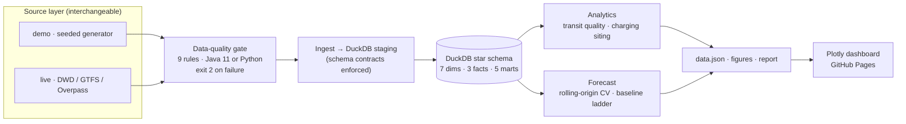
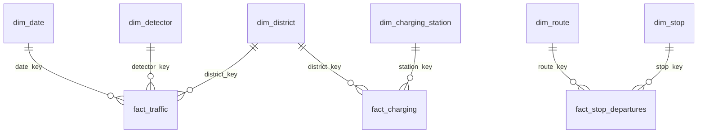

# Architecture

## Pipeline

Both source modes write the same files in the same schemas
(`src/ingomob/schemas.py`), so nothing downstream knows or cares which one ran.

## Star schema

| Layer | File | Builds |
|---|---|---|
| Dimensions | `sql/01_dimensions.sql` | `dim_date` (incl. public + school holidays), `dim_time`, `dim_district`, `dim_stop`, `dim_route`, `dim_detector`, `dim_charging_station` |
| Facts | `sql/02_facts.sql` | `fact_traffic`, `fact_stop_departures`, `fact_charging` |
| Marts | `sql/03_marts.sql` | `mart_hourly_profile`, `mart_daily_traffic`, `mart_route_service`, `mart_stop_service`, `mart_district_scorecard` |

## Module map

| Module | Responsibility |
|---|---|
| `config.py` | Environment-driven `Settings`, validated on load |
| `errors.py` | Typed exceptions, each with an actionable hint |
| `logging_conf.py` | Structured logging, level via `INGOMOB_LOG_LEVEL` |
| `schemas.py` | Column contracts shared by both source modes |
| `http_client.py` | Retries, backoff, disk cache, SHA-256 provenance |
| `sources/demo.py` | Seeded stochastic generator |
| `sources/live.py` | Real downloads + format parsers |
| `quality.py` / `java_validate.py` | Rule spec / engine dispatch |
| `warehouse.py` | DuckDB access, quote-aware SQL splitter |
| `features.py`, `forecast.py` | Leakage-audited features, rolling-origin CV |
| `siting.py`, `transit_quality.py` | Domain analytics |
| `export_dashboard.py`, `plots.py`, `report.py` | Outputs |
| `cli.py` | Subcommands, exit codes, `doctor`, `serve` |

## Design decisions

- **DuckDB** — embedded columnar warehouse: zero ops, standard SQL, single file, trivially
  reviewable in a portfolio context.
- **Star schema** — keeps marts simple and mirrors how a BI tool would consume the data.
- **Static client-side dashboard** — one generated `data.json` plus Plotly, so it deploys to
  GitHub Pages with no backend and no secrets.
- **Two source modes instead of faking one** — synthetic data keeps CI hermetic and
  deterministic; live mode proves the same code handles real formats.
- **Quality gate before ingestion** — bad data must fail loudly and early, not produce a
  clean-looking dashboard built on nonsense.
