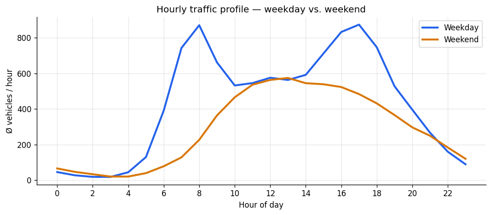
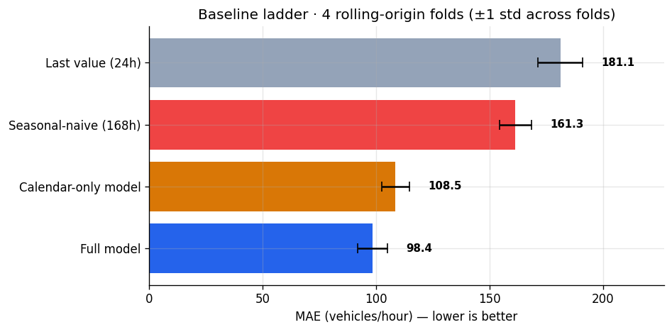
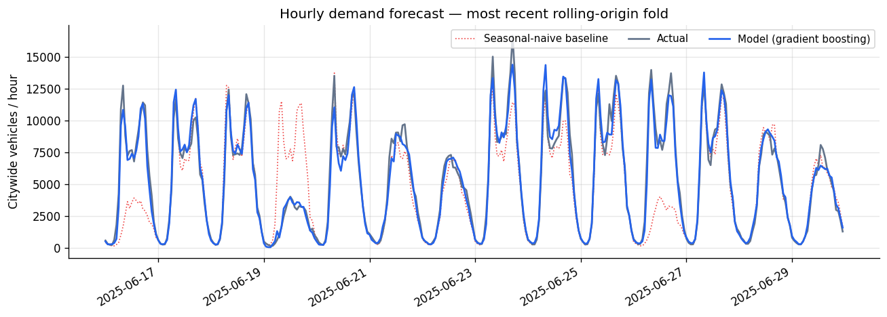
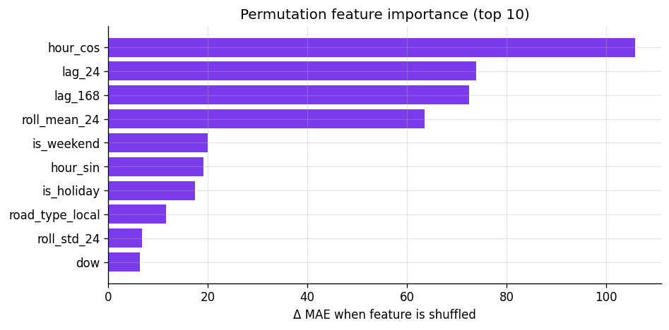
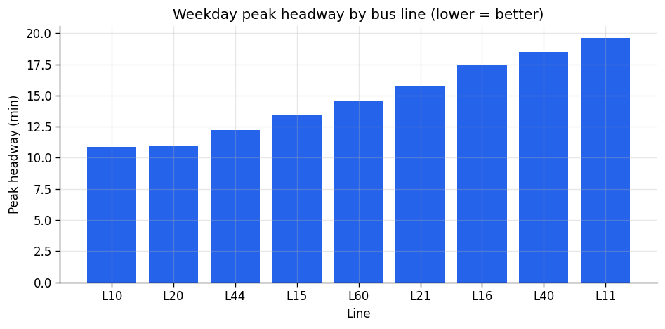
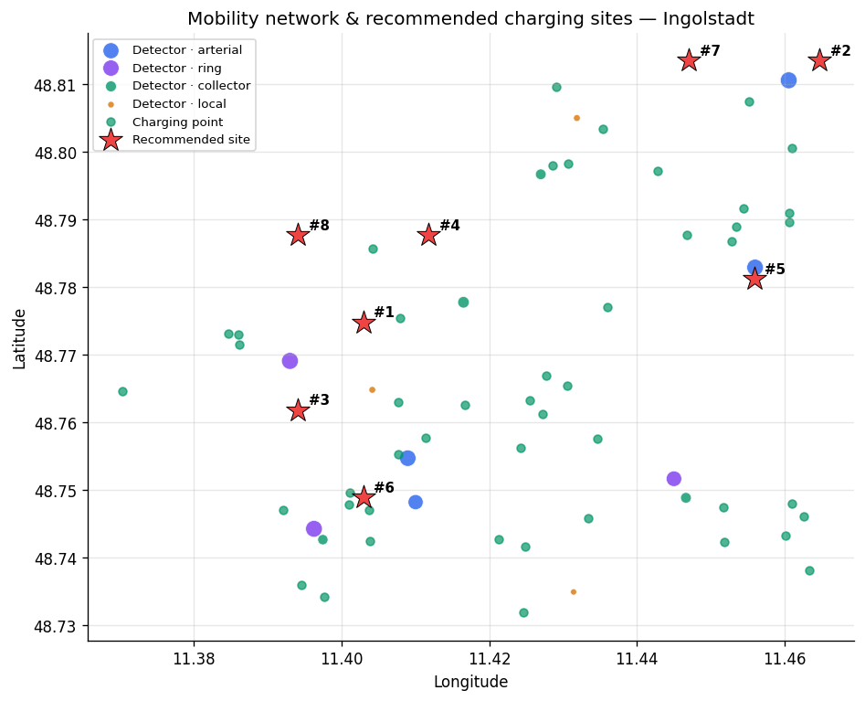

# Ingolstadt Mobility Intelligence — Analysis Report

Analysis window: **2025-01-01 → 2025-06-29** · generated by the IngoMobility pipeline.

> **Source mode: `demo`.** Figures below come from a seeded synthetic dataset built to the real Ingolstadt/VGI schemas. They demonstrate the method, **not** the state of the city. Run `ingomob run-all --source live` to execute the same pipeline on official open data.

---

## Executive summary

- **The demand model beats every baseline, but modestly.** Across
  4 rolling-origin folds (14-day horizons) it achieves
  **MAE 98.39 ± 6.55**
  (R² 0.84), versus
  161.35 for a seasonal-naive baseline and
  108.54 for a calendar-only model. The honest headline is the
  **9.4 % improvement over calendar-only** — the seasonal-naive
  comparison flatters the model and should not be quoted alone.
- **Public-transport supply is uneven.** Mean weekday peak headway is
  14.8 min, ranging from L10
  (10.9 min) to L11
  (19.6 min). 9 stops fall in the bottom
  service quintile; 8 have no Sunday service at all.
- **Charging shows spatial gaps.** The siting heuristic ranks
  8 candidate locations by unmet demand.
- **Nothing was analysed before it was validated.** The java data-quality gate checked
  **60,320 rows** against 9 rules and the pipeline aborts
  if any rule fails.

---

## 1. Method

Raw sources → data-quality gate → DuckDB star schema (dimensions → facts → marts) → analytics,
ML and BI. Every stage is deterministic and re-runnable via `ingomob run-all`.

| Domain | Grain | Rows |
|---|---|---|
| Traffic loop-detector counts | detector × day × hour | 60,221 |
| GTFS stop departures | trip × stop | 9,394 |
| Charging stations | station | 47 |

## 2. Traffic demand patterns

## 3. Demand forecast — evaluated against a ladder of baselines

Rolling-origin cross-validation, expanding window, 4 folds of
14 days. Reporting a single hold-out against a single weak baseline is the most
common way portfolio projects overstate model quality; this table exists to prevent that.

| Predictor | MAE (mean ± std) | RMSE | R² |
| --- | --- | --- | --- |
| Last value (t−24h) | 181.14 ± 9.93 | 340.84 | 0.47 |
| Seasonal-naive (t−168h) | 161.35 ± 7.13 | 304.98 | 0.57 |
| Calendar + weather model | 108.54 ± 6.19 | 204.91 | 0.81 |
| **Full model (lags + calendar)** | 98.39 ± 6.55 | 186.02 | 0.84 |

Most recent fold (2025-06-16 → 2025-06-29,
52,739 train / 4,641 test rows):

**Excluded by design:** `peak_base (generator parameter - leakage risk)`.
See [`docs/model_card.md`](../docs/model_card.md) for assumptions, biases and limits.

## 4. Public-transport service quality

| Line | Route | Weekday trips | Peak headway | Span | Stops |
| --- | --- | --- | --- | --- | --- |
| L10 | Hauptbahnhof - Zentrum - Klinikum | 70 | 10.9 min | 18.1 h | 11 |
| L20 | Hauptbahnhof - Audi - Nordwest | 67 | 11.0 min | 18.1 h | 9 |
| L44 | Ringsee - Hauptbahnhof - Nordost | 61 | 12.2 min | 18.3 h | 12 |
| L15 | Südwest - Rathausplatz - Etting | 58 | 13.4 min | 18.3 h | 8 |
| L60 | Friedrichshofen - Audi - Oberhaunstadt | 52 | 14.6 min | 18.0 h | 12 |
| L21 | Unsernherrn - Zentrum - Nordost | 50 | 15.7 min | 18.3 h | 8 |
| L16 | Ringsee - Zentrum - Oberhaunstadt | 45 | 17.4 min | 18.2 h | 8 |
| L40 | Südost - Klinikum - Etting | 43 | 18.5 min | 18.2 h | 12 |
| L11 | Friedrichshofen - Zentrum - Nordost | 41 | 19.6 min | 18.2 h | 11 |

Weekend service runs at **37.6 %** of weekday level.
*Headway is the mean gap between consecutive first-stop departures inside the 07:00-09:00 and 16:00-18:00 windows. Underserved = bottom quintile of weekday departures among stops with any service.*

## 5. Charging infrastructure — siting candidates

*Method: heuristic gap score (normalised demand minus normalised supply).* Caveats: gap_score is ordinal, not a physical unit; grid capacity, land availability and cost are not modelled; OSM/demo charging inventory may be incomplete.

| Rank | Nearest district | Gap | Demand | Supply | Lat, Lon |
| --- | --- | --- | --- | --- | --- |
| 1 | Nordwest | 0.349 | 0.641 | 0.292 | 48.77471, 11.40294 |
| 2 | Oberhaunstadt | 0.325 | 0.405 | 0.08 | 48.81353, 11.46471 |
| 3 | Ringsee | 0.213 | 0.645 | 0.432 | 48.76176, 11.39412 |
| 4 | Nordwest | 0.211 | 0.299 | 0.088 | 48.78765, 11.41177 |
| 5 | Nordost | 0.174 | 0.523 | 0.349 | 48.78118, 11.45588 |
| 6 | Südwest | 0.154 | 1.0 | 0.846 | 48.74882, 11.40294 |
| 7 | Oberhaunstadt | 0.148 | 0.309 | 0.161 | 48.81353, 11.44706 |
| 8 | Nordwest | 0.132 | 0.214 | 0.082 | 48.78765, 11.39412 |

## 6. District scorecard

| District | Ø traffic/day | Detectors | Stops | Weekday dep. | Charge pts | kW |
| --- | --- | --- | --- | --- | --- | --- |
| Ringsee | 27,026 | 3 | 5 | 558 | 12 | 582 |
| Nordwest | 22,023 | 2 | 6 | 803 | 2 | 100 |
| Südwest | 18,763 | 2 | 5 | 281 | 17 | 1,049 |
| Nordost | 17,513 | 1 | 6 | 480 | 10 | 326 |
| Oberhaunstadt | 17,385 | 1 | 4 | 153 | 5 | 155 |
| Südost | 17,044 | 2 | 6 | 701 | 14 | 671 |
| Etting | 8,572 | 2 | 5 | 693 | 13 | 410 |
| Unsernherrn | 2,140 | 1 | 6 | 527 | 8 | 121 |
| Friedrichshofen | 0 | 0 | 5 | 455 | 10 | 349 |
| Mitte | 0 | 0 | 4 | 269 | 23 | 253 |

## 7. Recommendations

1. Use the demand model for day-ahead operational planning, where an
   9.4 % error reduction over a calendar heuristic is
   material — not for long-horizon strategic forecasts, which it was not validated for.
2. Rebalance bus frequency toward the weakest lines; the gap between best and worst peak
   headway is 8.7 min.
3. Close the 8 Sunday-service gaps before adding new routes.
4. Treat the charging shortlist as a screening step for a proper siting study, not as a decision.

## 8. Limitations

- On the `demo` source the target is synthetic: metrics show how well the model recovers a known
  stochastic process, not real-world forecast skill.
- The City of Ingolstadt does not publish an open hourly loop-detector feed, so `live` mode covers
  weather, GTFS and charging only (see `DATA_SOURCES.md`).
- The siting score is ordinal and ignores grid capacity, land and cost.
- No GTFS-Realtime, so scheduled service is analysed, not actual punctuality.
